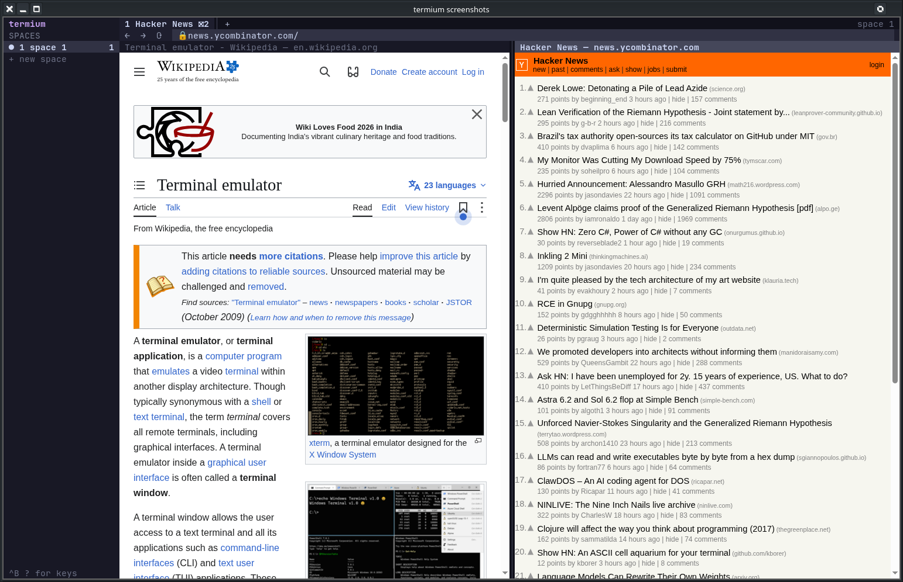
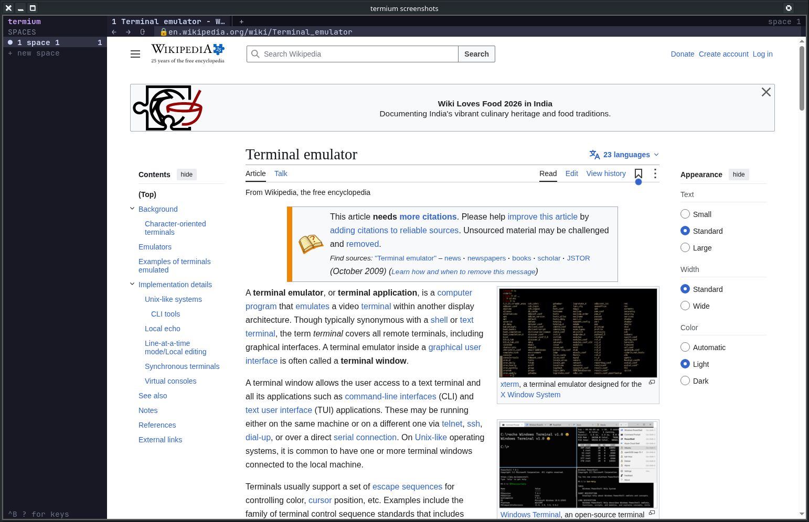
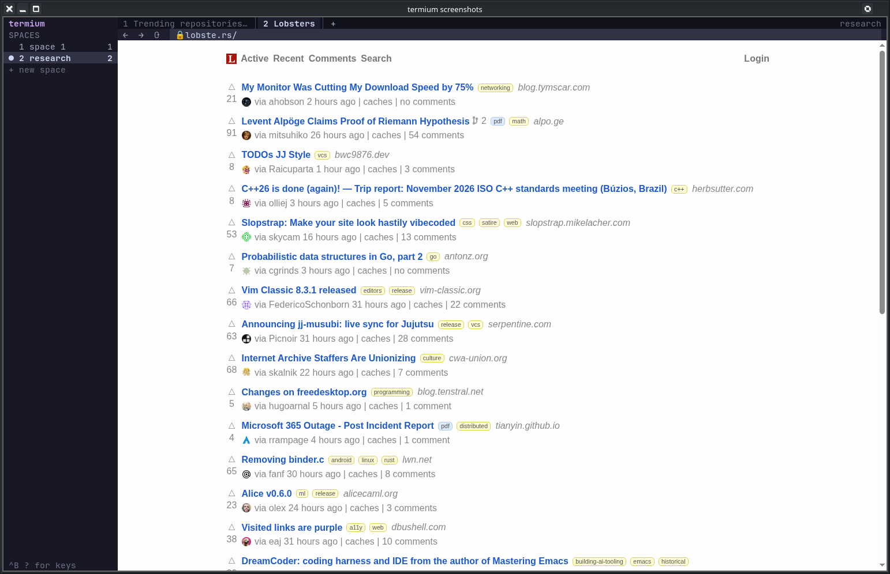
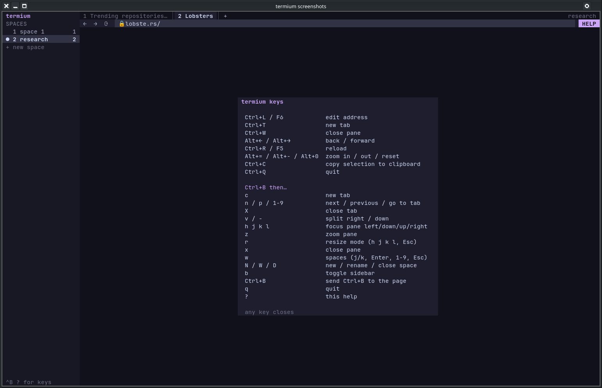
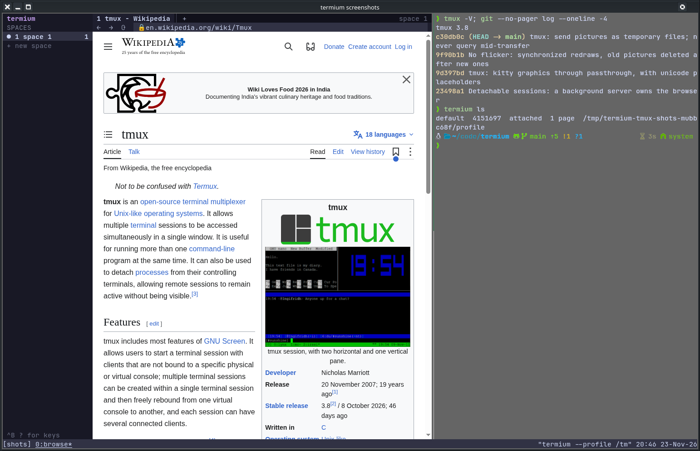
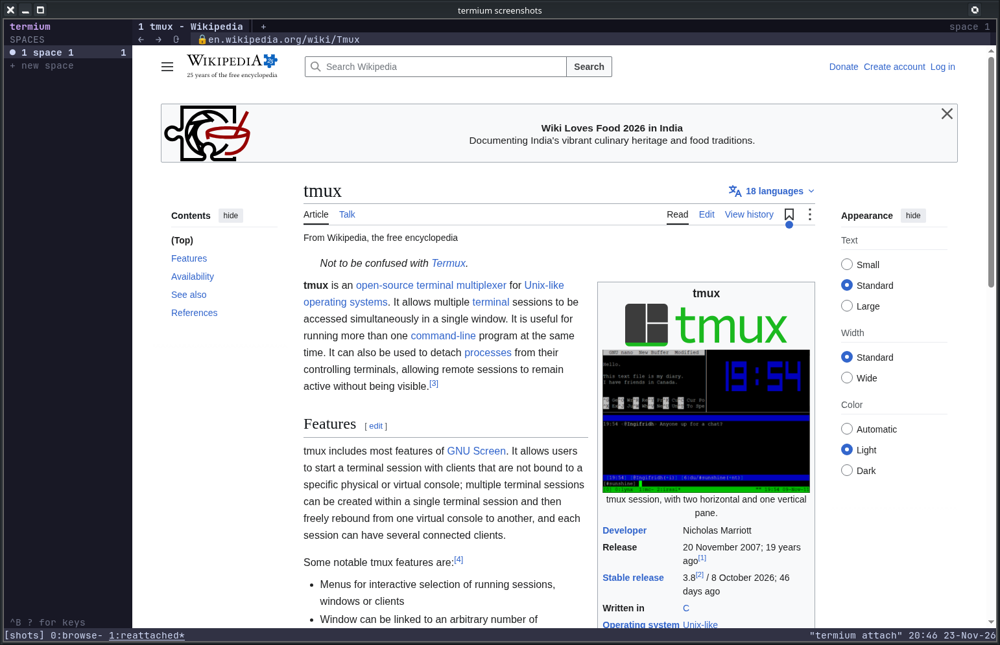

# termium

A Chromium browser in your terminal: termium drives a headless
[Helium](https://helium.computer) (Chromium) over the DevTools protocol and
draws the page with the kitty graphics protocol. Written in TypeScript for
[Bun](https://bun.sh).



It is to [Carbonyl](https://github.com/fathyb/carbonyl) what
[Browsh](https://www.brow.sh) is to Firefox, minus the fork: no Chromium
build, just your installed Helium (so you get its patches, including the
built-in content blocker) running headless. Pages are drawn as real images,
not character art, so text is sharp and video, canvas and WebGL work.

## Features

- **Detachable sessions**, like tmux: the browser runs in a background
  session; detach with `Ctrl+B d` and attach again from any terminal, at
  any size, with every page as you left it.
- **Works inside tmux and herdr** (see [tmux and herdr](#tmux-and-herdr)).
- **Agents can drive it while you watch** (see [Agents](#agents)):
  `termium ctl` gives scripts and coding agents (Claude Code, Codex...)
  snapshots, clicks, typing and screenshots without a terminal, and every
  session has a DevTools endpoint for Puppeteer, Playwright and
  chrome-devtools-mcp. `termium --skill` prints a skill that teaches them.
- **Spaces, tabs and split panes**, arranged like
  [herdr](https://herdr.dev): spaces (think browser windows) in a sidebar,
  tabs along the top, and any tab split into panes, each a live page.
- **Real input.** Pixel-precise mouse (click, double click, drag, hover,
  wheel), full keyboard via the kitty keyboard protocol (key up and down,
  modifiers, shortcuts inside web apps), bracketed paste.
- **Address bar** with search (DuckDuckGo by default), back, forward,
  reload; JavaScript `alert`, `confirm` and `prompt` dialogs; popups and
  `target=_blank` links open as tabs; downloads go to your download
  directory; file inputs ask for a path; `<select>` dropdowns open as an
  in-page menu (headless Chromium never paints native ones).
- **Looks like regular Chrome** to sites (no `HeadlessChrome` user agent or
  `navigator.webdriver`), so they don't serve bot checks.
- **Copy** the page selection to your clipboard with Ctrl+C (OSC 52).
- **Zoom** with Alt+= / Alt+- / Alt+0; the page scale follows your terminal
  font size by default.
- A persistent profile (logins survive restarts), or `--incognito`.

| | |
| --- | --- |
|  |  |
| Browsing | Spaces in the sidebar, tabs on top |
|  |  |
| Two panes in one tab | Ctrl+B ? shows every key |
|  |  |
| In a tmux split | Detached, then attached from another tmux window |

## Usage

```sh
termium                         # opens with the address bar focused
termium news.ycombinator.com    # or start on a page
termium --incognito             # throwaway profile, deleted when the session ends
termium --help
```

Options: `--browser <path>` (default: Helium on `PATH`, or
`$TERMIUM_BROWSER`), `--profile <dir>` (default
`~/.local/share/termium/profile`, or `.../profiles/NAME` for a session
started with `-s NAME`), `--incognito`, `--scale <n>` (device
pixels per CSS pixel), `--search <url-with-%s>` (or `$TERMIUM_SEARCH`).
They apply when a session starts. `--no-update-check` turns off the
[update check](#updates).

### Sessions

termium runs the browser in a background session, so it survives the
terminal it was started from:

```sh
termium                  # attach to the session "default", starting it if needed
termium example.com      # ...and open a page (in a new tab if it's running)
termium -s work          # another session, with its own browser and profile
termium -s temp --incognito   # ...or with a throwaway profile
termium attach [name]    # attach to a running session
termium ls               # list sessions (attached or detached, pages, profile)
termium kill [name]      # end a session and its browser
termium open example.com --split right   # in a new split of tmux, herdr or kitty
```

- `Ctrl+B d` detaches: the terminal gets its shell back, the browser and
  every page keep running. Attaching again, from
  this terminal or another of any size, redraws everything at the new
  size.
- `Ctrl+Q` ends the session, as before (it asks first if a page may have
  unsaved changes).
- One terminal at a time: attaching from a second terminal takes the
  session over, and the first is told it was detached (like
  `tmux attach -d`).
- Closing the terminal (or `kill`ing the `termium` in it) only detaches.
  If the session itself dies, an attached terminal gets its screen back
  with a message.
- `--split right|down` asks the terminal termium runs in for a real split
  next to the current pane, which runs termium there (attaching to the
  session, or starting it); errors stay on screen in it. It works in tmux, herdr and kitty (with remote control on,
  `allow_remote_control yes`, in a tab with the splits layout). Ghostty
  and WezTerm can't be asked yet: termium says so, and its own splits
  (`Ctrl+B v` / `-`) work everywhere.
- `--browser`, `--profile`, `--incognito`, `--scale` and `--search`
  apply when a session starts; given to a running one they're an error
  (start another with `-s NAME`).
- Sessions listen on a Unix socket in `$XDG_RUNTIME_DIR/termium/` (else
  `termium-<uid>` in the temp dir), readable only by you. A socket left
  by a session that was killed outright is removed by `termium ls`,
  `termium kill` or the next start.

### tmux and herdr

**tmux** (3.3 or later) passes termium's pictures on only if you allow it,
in `~/.tmux.conf`:

```
set -g allow-passthrough on
```

termium says so if it's off. The terminal running tmux must support the
kitty graphics protocol (Ghostty, kitty, WezTerm). Inside tmux, pages are
drawn with unicode placeholders, so they stay in their pane through splits,
zoom and redraws, and pictures are handed to the terminal as temporary
files (in `/dev/shm`) when it runs on the same machine. `allow-passthrough
all` also keeps pictures current while the pane is in a hidden window;
with `on`, a page that changed while hidden shows its old picture until it
changes again.

**herdr** needs no setup: it draws termium's pictures itself. (The first
time herdr runs it shows an introduction that takes the keyboard until you
dismiss it: Enter, then Esc.)

tmux and herdr both use `Ctrl+B` as their prefix too: press it twice to
reach termium (`Ctrl+B Ctrl+B d` detaches termium), or change one of the
prefixes.

### Agents

An agent (Claude Code, Codex, a script) can drive a session while you
watch it in your terminal, a tmux or herdr pane say: everything it does
shows as it happens (and is named in the status line as `agent: ...`,
never with what it typed: a password stays unshown), and it never takes
over your terminal or keyboard. While you're busy (editing the address
bar, answering a prompt, reading help, or typing), an agent waits before
switching tabs or acting on the tab you're on, and a new tab it opens
stays in the background. Agents' acting commands run one at a time.

```sh
termium start -s agent [url]   # start a session without a terminal (returns once it's up)
termium attach agent           # watch it (in a pane of your own)
termium ctl -s agent open https://example.com --new-tab
termium ctl -s agent snapshot  # accessibility tree, elements with ids like [3:142@2]
termium ctl -s agent click 3:142@2
termium ctl -s agent type 3:57@2 "hello" --submit
termium ctl -s agent wait text "Thanks"
termium ctl -s agent text      # the page's text; also: shot, eval, key, scroll, tabs...
termium devtools agent         # http://127.0.0.1:PORT for Puppeteer, Playwright, MCP
termium --skill                # a SKILL.md that teaches an agent all this
```

- **`termium ctl`** speaks to the session over its socket (no terminal
  needed) and acts through the session's own DevTools connection:
  `tabs`, `open`, `select`, `close`, `snapshot`, `text`, `click`, `type`,
  `key`, `scroll`, `shot`, `eval`, `wait`, `dialog` (`termium ctl --help`).
  Tabs are numbered (one per pane); element ids are `TAB:NODE@DOC`, good
  while the element exists in that document (a new document makes them
  stale). `--json` for machine-readable output; exit status 0 done, 1
  failed, 2 usage, 3 no such session, 4 timed out, 5 partly done.
- **`termium start`** starts a session in the background with no
  terminal (pages opened then are 1280x800; a terminal that attaches sizes
  them to its panes, and they keep that size when it detaches). On a
  running session it says so (opening its URL there) and exits 0; two at
  once start one session, with both URLs.
- **The DevTools endpoint.** Every session's browser listens for DevTools
  clients on `127.0.0.1` (a free port, new each start; `termium devtools
  [NAME] [--json]` prints it), besides termium's own private pipe:
  `npx chrome-devtools-mcp --browser-url=http://127.0.0.1:PORT`,
  Playwright's `chromium.connectOverCDP(url)`, Puppeteer's
  `puppeteer.connect({browserURL: url, defaultViewport: null})` (finish
  with `disconnect()`: `close()` quits the session's browser). Tabs they
  open show in termium's current space and tabs they close go away. A
  viewport they set (Puppeteer's default 800x600, `setViewport`) holds
  while they're connected (termium shows the page stretched to the pane,
  says so once, and maps the mouse to match) and termium's own comes back
  when they disconnect.
- The endpoint has no authentication: while a session runs, any program
  on this machine that can reach `127.0.0.1` (another user's included) can
  drive its browser and read its pages and cookies. Use a separate
  session (`-s NAME`, its own profile) or `--incognito` for anything an
  agent does if that matters to you.
- `termium --skill` prints a `SKILL.md` (with `name` and `description`
  frontmatter) covering all of this for an agent: save it as
  `~/.claude/skills/termium/SKILL.md` for Claude Code, or point any agent
  at it.

### Keys

Browser keys work directly; layout keys follow herdr's `Ctrl+B` prefix.

| Key | Action |
| --- | --- |
| Ctrl+L, F6, Alt+D | edit the address (Enter goes, Esc cancels) |
| Ctrl+T / Ctrl+W | new tab / close pane |
| Alt+← / Alt+→, mouse back/forward | back / forward |
| Ctrl+R, F5 (Ctrl+Shift+R hard) | reload |
| Alt+= / Alt+- / Alt+0 | zoom in / out / reset |
| Ctrl+C | copy the selection to the clipboard |
| Ctrl+Q | quit (works everywhere, even mid-prompt) |
| **Ctrl+B then** | |
| `c`, `n` / `p`, `1`-`9`, `X` | new / next / previous / go to / close tab |
| `v` / `-` | split right / down |
| `h` `j` `k` `l` (or arrows) | focus the pane in that direction |
| `z` | zoom the focused pane |
| `r` | resize mode: `h` `j` `k` `l` (Shift for bigger steps), Esc ends |
| `x` | close pane |
| `w` | pick a space: `j` / `k`, Enter, `1`-`9`, Esc |
| `N` / `W` / `D` | new / rename / close space |
| `b` | show or hide the sidebar |
| `Ctrl+B` | send Ctrl+B to the page |
| `d` | detach (the session keeps running; `termium attach` resumes) |
| `U` | update termium, or restart the session into an installed update |
| `q` / `?` | quit / show keys |

While the address bar is open, Ctrl+T, Ctrl+R, Alt+←/→, zoom and the
`Ctrl+B` prefix still work, and Ctrl+W closes the tab as in Chrome; its own
editing keys are Ctrl+A/E (start/end), Ctrl+U/K (delete to start/end),
Ctrl+Backspace (delete word) and Alt/Ctrl+←/→.

The mouse works on everything: click tabs (middle click closes), spaces,
the back, forward and reload buttons, the address, pane titles, and drag the
divider between panes.

### Updates

```sh
termium check-update     # is there a newer release? (one line)
termium update           # update to it (a release binary only)
```

- **The check.** When a terminal attaches, the session asks GitHub for
  termium's latest release in the background, after the UI is up:
  `GET https://github.com/alimohammed1624/termium/releases/latest` (the tag
  is read from the redirect, which is not followed), falling back to
  `https://api.github.com/repos/alimohammed1624/termium/releases/latest`.
  The request carries only a `termium/<version>` User-Agent. It never
  delays anything: failures are silent (offline means no badge) and it
  gives up after 3 s in all (both sources together), or as soon as the
  terminal detaches (nothing is recorded then). The answer is cached (best
  effort: if another termium holds the cache's lock, it isn't written) in
  `~/.local/state/termium/update-check.json` (`$XDG_STATE_HOME`); a cached
  newer release shows at once, then the check refreshes it (a failed check
  keeps what was cached). Pre-releases are never offered.
- **Once per session.** The session server owns the check, its cache and
  the update box, so attaching, detaching and taking over don't repeat
  them: it checks on the first attach and then at most once a day while a
  terminal stays attached, never while detached, and offers each release
  once in a session's life.
- **What you see.** A newer release shows `↑ vX.Y.Z` at the right end of
  the tab bar (just `↑` in a narrow terminal), and `Ctrl+B ?` shows the
  upgrade command. It's offered once, as a notice at the right of the
  address line, "termium X is available (you have Y) · Ctrl+B U", shown
  while nothing else is open there (no dialog, address editing, help).
  The notice never takes the keyboard: everything you type or paste goes
  to the page as usual. To answer it, press `Ctrl+B U` or click the notice
  or the badge: a box opens with `u` update now, `l` later (not offered
  again in this session unless a newer release comes out; asked again when
  the session restarts) and `s` skip this version (never offered again;
  the badge stays; if another termium keeps the update cache locked for
  10 s, it holds for this session only, and termium says so). Only those letters act: `Esc` closes the box, and
  any other key (Enter and Space included) closes it and goes on to the
  page. A terminal that attaches or takes over always starts typing into
  the page: an open box, help or address editing is closed. Any other key closes the box and goes on as usual, and
  a paste closes it and reaches the page.
- **Updating.** `u` (or `termium update` from a shell) downloads this
  platform's archive and `SHA256SUMS` from the release, checks the
  archive's SHA-256, checks that it holds a native executable for this
  machine (ELF or Mach-O, right CPU, about the right size; nothing else is
  ever run), runs the new binary's `--version` and renames it over
  the running binary (symlinks resolved; written beside it first, so the
  old one is never half-replaced). On any failure nothing changes and
  termium shows the `install.sh` command to update by hand. termium
  refuses to update itself when it runs from source (`bun src/main.ts`, or
  a `bun install -g` install: use `git pull` or `bun install -g` again),
  when there is no prebuilt binary for the platform, or when it can't
  write to the binary's folder.
- **Restarting.** A running session keeps running the old version until
  it restarts. After `u`, the box offers `r`: restart now. The session
  closes its browser and starts again from the binary the update replaced
  (the session's own, whichever termium the attached terminal runs) in the
  same terminal, with its spaces, tabs, splits and zoom: pages reload from
  their addresses, logins survive in the profile (not with
  `--incognito`), anything typed into a page and not saved is lost, so if
  a page may have unsaved changes (or a download is running) termium asks
  first, as `Ctrl+Q` does. `l` leaves it for later (`Ctrl+B U` offers it
  again; the badge shows `↻ vX.Y.Z`). After `termium update` from a shell, the next attach
  (from the new binary) offers the same restart, as a notice, and the
  restart runs that newer binary whichever terminal presses `r` (once it's
  checked to still be there and report that version; if not, there's no
  restart and termium says so). If a
  restart fails to start the session, its spaces and tabs are kept: the
  next `termium` (or `termium -s NAME`) within 10 minutes starts it with
  the profile and options it had and reopens them; started with any other
  launch option (another `--profile`, `--scale`, …), the snapshot is kept
  and termium says so. It's removed only once every page in it reopened;
  otherwise it's kept and termium says so. Two updates at once
  (two sessions, or a shell) take turns, and never replace a newer
  termium with an older one.
- **Older copies.** A terminal whose termium is older than the session's
  (another copy was updated) is told so when it detaches.
- **Sessions of older termiums.** A session started by termium 0.2.0 (before
  an update) can't restart itself or keep its pages across a restart: when
  a newer termium attaches to it, it says so in the shell and asks, once
  per session, whether to restart it now (its pages close; logins stay in
  the profile), and reminds you how when you detach (not with the
  opt-outs below). A session started by
  a termium whose session protocol differs can't be attached; termium says
  so and how to end it (`termium kill NAME`).
- **Turning it off.** `--no-update-check`, `TERMIUM_NO_UPDATE_CHECK=1`,
  or a set `CI` variable (empty, `0` and `false` don't count) turn off the
  check and all update news (badge, notice, box, the question about older
  sessions) for that terminal, even
  when it takes over a session another terminal had them in. termium has no config
  file, so there's no config option. `termium ls`, `kill`, `--version`
  and `--help` never go online. `termium check-update` checks on demand
  (ignoring the opt-outs and refreshing the cache) and exits 0 when up to
  date, 100 when a newer release is available and 1 when it could not
  check; `termium update` exits 0 when updated or already up to date and
  1 on failure (always with the `install.sh` command to update by hand);
  both exit 2 on bad usage.

### Good to know

- Helium holds network requests for a few seconds after it starts while its
  built-in content blocker loads, so the very first page can take a moment,
  and Helium may reload a page that loaded before the blocker was ready
  (anything typed into it in those first seconds is lost).
- Only one session can use a profile at a time. Each named session
  (`termium -s NAME`) has its own, `~/.local/share/termium/profiles/NAME`
  (the default session keeps `~/.local/share/termium/profile`); `--profile`
  or `--incognito` choose another. Plain `termium` again just attaches to
  the session that's running. If a session was killed
  outright (`kill -9`), the next start stops the browser it left behind.
- Logs: `~/.local/state/termium/termium.log` (set `TERMIUM_DEBUG=1` to log
  DevTools traffic) and `browser.log` next to it.
- Downloads go to `$TERMIUM_DOWNLOAD_DIR`, else your XDG download directory
  (`xdg-user-dir DOWNLOAD`), else `~/Downloads`, and never replace an
  existing file (`name (1).ext`).
- Closing a pane lets the page ask "Leave this page?" first, as a browser
  would. Closing a tab of several panes, or a space, asks once if any page
  in it may have unsaved changes, and closes all or nothing.
- Browser shortcuts that would act on the hidden browser (Ctrl+Shift+W,
  Ctrl+N, …) are not passed on; ones pages use themselves (Ctrl+S, Ctrl+K,
  Ctrl+F, …) reach the page.
- Known limits of headless Chromium: background tabs still count as
  visible, WebGL runs on the SwiftShader software renderer,
  `window.outerWidth`/`outerHeight` report the headless window's size
  rather than the page's, and zoom applies to all pages rather than per
  site.
- Pasting gives clipboard access to the page you paste into, for that
  paste only, and empties the browser's clipboard afterwards, so no other
  site can read it.
- A page that crashed or hung (Helium blocks some `chrome://` pages that
  way) is replaced by a fresh one on the next reload or address; a page
  that is only busy is left alone.
- A dialog from a page you're not looking at waits (its tab shows `!`)
  instead of taking focus.
- Ctrl+Q asks first if a page may have unsaved changes or a download is
  running; press it again to quit anyway. (It goes by whether a page has
  an unsaved-changes handler, so some sites ask even with nothing unsaved.)
- Nothing is copied out of password fields.
- Not supported yet: HTTP authentication prompts, date and colour pickers,
  and copying from a page's own "copy" buttons to your clipboard (select
  the text and press Ctrl+C instead).
- The page is a bitmap, so termium needs a graphics-capable terminal. It
  checks on startup and says so if yours is not.

## How it works

`termium` is a thin client: it sets up the terminal, works out what it
supports, parses its input and draws what it is sent. The session server
it attaches to (started on demand, in the background) owns everything
else; the two speak a small framed protocol over the session's Unix
socket, and the client acknowledges each frame once its terminal has
taken it, so the browser still produces frames only as fast as the
terminal shows them. While no terminal is attached nothing is drawn and
the screencasts stop.

The server starts Helium with `--headless=new` and speaks the DevTools
protocol over a private pipe (`--remote-debugging-pipe`), auto-attaching
to every page, cross-site iframe and worker; a page another DevTools
client opens on the session's loopback endpoint (`--remote-debugging-port=0`,
see [Agents](#agents)) is attached the same way and becomes a tab. Each visible pane gets a
viewport matching its size in device pixels (cell size × cells) and a PNG
screencast; frames are sent to the terminal as kitty graphics images,
placed and scaled to the pane's cells, and acknowledged only once the
terminal has taken them, so the frame rate adapts to the terminal. Input
arrives through the kitty keyboard protocol and SGR-pixel mouse reports and
goes back as `Input.dispatchKeyEvent` / `Input.dispatchMouseEvent`.

## Install

```sh
curl -fsSL https://raw.githubusercontent.com/alimohammed1624/termium/main/install.sh | sh
```

The script picks the prebuilt binary for your machine — Linux x86_64 or
aarch64 (glibc, or musl on Alpine and similar), macOS Intel or Apple
silicon — from the latest
[GitHub release](https://github.com/alimohammed1624/termium/releases),
checks it against the release's `SHA256SUMS` and installs it to
`~/.local/bin` without sudo (it tells you the line to add if that is not on
your `PATH`). The binary bundles the Bun runtime, so Bun is not needed.
Options:

- `TERMIUM_INSTALL_DIR=/some/dir` — install somewhere else.
- `TERMIUM_VERSION=v0.1.0` — install a specific release instead of the latest.
- `TERMIUM_TARGET=x86_64-apple-darwin` — pick the archive yourself (any
  target from the table below).

```sh
curl -fsSL https://raw.githubusercontent.com/alimohammed1624/termium/main/install.sh | TERMIUM_INSTALL_DIR=~/bin sh
```

To read the script before running it:

```sh
curl -fsSL https://raw.githubusercontent.com/alimohammed1624/termium/main/install.sh -o install.sh
less install.sh
sh install.sh
```

**What termium needs at run time:**

- [Helium](https://helium.computer) (or another Chromium-based browser)
  installed.
- A terminal that speaks the kitty graphics protocol.
  [Ghostty](https://ghostty.org) is recommended.

**Update:** `termium update`, or run the install command again (see
[Updates](#updates)).

**Uninstall:** delete the binary (`rm ~/.local/bin/termium`).

**Release archives by hand.** Each release has these archives plus
`SHA256SUMS`; each `termium-<target>.tar.gz` contains a `termium-<target>/`
directory with the binary:

| Archive | Platform |
| --- | --- |
| `termium-x86_64-unknown-linux-gnu.tar.gz` | Linux x86_64 (glibc) |
| `termium-aarch64-unknown-linux-gnu.tar.gz` | Linux aarch64 (glibc) |
| `termium-x86_64-unknown-linux-musl.tar.gz` | Linux x86_64 (musl; needs `libstdc++`, `libgcc`) |
| `termium-aarch64-unknown-linux-musl.tar.gz` | Linux aarch64 (musl; needs `libstdc++`, `libgcc`) |
| `termium-x86_64-apple-darwin.tar.gz` | macOS Intel |
| `termium-aarch64-apple-darwin.tar.gz` | macOS Apple silicon |

```sh
base=https://github.com/alimohammed1624/termium/releases/latest/download
curl -fsSLO "$base/termium-aarch64-apple-darwin.tar.gz" -O "$base/SHA256SUMS"
grep ' termium-aarch64-apple-darwin.tar.gz$' SHA256SUMS | shasum -a 256 -c
tar xzf termium-aarch64-apple-darwin.tar.gz
install -m 755 termium-aarch64-apple-darwin/termium ~/.local/bin/
```

On Linux, use `sha256sum -c` and the `-unknown-linux-gnu` archive name.

**With Bun:**

```sh
bun install -g github:alimohammed1624/termium
```

**From source:**

```sh
git clone https://github.com/alimohammed1624/termium && cd termium
bun install
bun src/main.ts                  # run it straight from source
bun run build                    # standalone binary: dist/termium
```

## Releasing

Releases run on GitHub Actions (`.github/workflows/release.yml`). Bump
`version` in `package.json`, add a `## [X.Y.Z]` CHANGELOG section (it
becomes the release text), merge to `main`, then push a matching tag:

```sh
git tag -a v0.2.0 -m "termium v0.2.0" && git push origin v0.2.0
```

The workflow checks that the tag equals `v` + the `package.json` version
and is on `main`, runs the typecheck and tests, cross-compiles every target
on one Linux runner with `bun build --compile`, installs each platform's
archive with `install.sh` on a matching runner (Linux x86_64 and aarch64,
macOS, and Alpine for musl), and publishes the archives with `SHA256SUMS`.
A tag with a `-suffix` (`v0.2.0-rc.1`) makes a pre-release. Running it by
hand from the Actions tab is a dry run: everything except publishing, with
the archives kept as the `dist` artifact.

Asset names carry no version, so
`https://github.com/alimohammed1624/termium/releases/latest/download/<asset>`
always points at the newest release. `install.sh`, `scripts/release.sh`
(via `TERMIUM_TARGETS` in `scripts/lib.sh`) and `release.yml` share the
target list and archive layout; change them together.

`scripts/release.sh vX.Y.Z` is the fallback when Actions is unavailable; see
[Optional local tooling](#optional-local-tooling).

## Development

```sh
bun install
bun src/main.ts       # run from source
bun run typecheck     # tsc --noEmit
bun test              # tests in tests/
bun run build         # dist/termium for this machine
```

End-to-end check against the real stack (real termium, real headless
Helium, a local test page) in a pseudo-terminal that answers like Ghostty;
it types, clicks, scrolls, splits, opens spaces and dialogs, and checks the
page state through DevTools. Needs Helium and Python 3 with `pyte` and
`Pillow`:

```sh
python3 tests/e2e.py /tmp/termium-e2e    # screenshots land there
python3 tests/lifecycle.py               # second instances, kill -9 recovery, bad terminals
python3 tests/sessions.py                # detach, re-attach, takeover, ls/kill, dead servers
python3 tests/agent.py                   # termium ctl / start / devtools / --skill, another DevTools client
python3 tests/multiplexers.py /tmp/mux   # inside a private tmux server and herdr session
python3 tests/host-splits.py /tmp/splits # open --split and ctl split in tmux and herdr
python3 tests/update.py                  # update check and self-update, with a fake GitHub
```

`tests/multiplexers.py` needs tmux 3.3 or later (and runs the herdr part
if herdr is installed); it starts its own tmux server and herdr session
and removes them. `tests/ghostty-flicker.py` is a manual check in a real
Ghostty window (see its header): it captures the window over and over while
browsing and counts frames where a page shows no picture.

CI runs both against Google Chrome (runners have no Helium), alongside the
type check, unit tests and builds.

`scripts/screenshots.sh` regenerates `docs/screenshots/` from a real Ghostty
window (KDE's Spectacle captures it; keep that window focused);
`scripts/screenshots.sh tmux` takes the tmux ones.

CI runs on GitHub Actions (`.github/workflows/ci.yml`) on every push to
`main`, every pull request and by hand: `bun install --frozen-lockfile`,
typecheck and tests on Linux and macOS, a `bun build --compile` of every
release target (the Linux and macOS binaries must answer `--version`),
shellcheck and actionlint. A new push to a pull request cancels its older
runs. Both workflows pin the Bun version (`BUN_VERSION`), since the release
binaries embed the runtime.

### Optional local tooling

Nothing below is required; it is a local pre-flight and a fallback for when
GitHub Actions is unavailable.

```sh
scripts/ci.sh              # install, typecheck, tests, every target build, lints
scripts/setup-hooks.sh     # opt in to the git hooks below, check tools
```

- `scripts/ci.sh` runs the CI checks on the committed `HEAD` (`--sha REV`
  for another commit). `--quick` runs only install, typecheck and tests;
  `--mac` also runs them (plus a native `bun-darwin-arm64` build and
  `--version`) on a Mac over ssh, reported as skipped if the Mac is
  offline. The log and result go to `.git/termium-ci/<sha>.log` and
  `.status`.
- Git hooks, off until you run `scripts/setup-hooks.sh` (it sets
  `core.hooksPath=.githooks`; `git config --unset core.hooksPath` turns them
  off again):
  - `post-commit` runs `scripts/ci.sh --mac` in the background for every
    commit on `main` and shows a desktop notification when it is done
    (`notify-send` or D-Bus; if neither works, or on failure, the next hook
    prints the result). `TERMIUM_SKIP_CI=1` skips it; `TERMIUM_CI_ARGS`
    overrides the flags.
  - `pre-push` refuses to push `main` if its local CI failed. If CI is
    missing or still running, `TERMIUM_PREPUSH=wait` (default) waits for it
    or runs it, `warn` pushes anyway, `block` refuses. `git push
    --no-verify` bypasses it.
- `scripts/release.sh vX.Y.Z` is the fallback release path: from a clean,
  pushed `main` that has passed local CI, it cross-compiles every target
  here, runs this machine's binary (and the Apple silicon one on the Mac,
  if reachable) with `--version`, writes `dist/` with the same assets and
  `SHA256SUMS` as the workflow, then tags, pushes the tag and runs
  `gh release create`. `--dry-run` stops after `dist/`. The pushed tag also
  starts the release workflow, which leaves the existing release alone.

The local tools need Bun and `flock`; `ssh`, shellcheck, actionlint,
`notify-send` and `gh` are optional (`gh` publishes releases). The Mac is
the ssh host `TERMIUM_MAC_HOST` (default `mba`); it needs non-interactive
ssh (`BatchMode`) and Bun (`scripts/setup-hooks.sh --mac` installs it for
the user). It gets the exact commit via `git archive` over ssh and works in
`~/.cache/termium-ci/`.


Release history: [CHANGELOG.md](CHANGELOG.md). License: MIT, see
[LICENSE](LICENSE).
